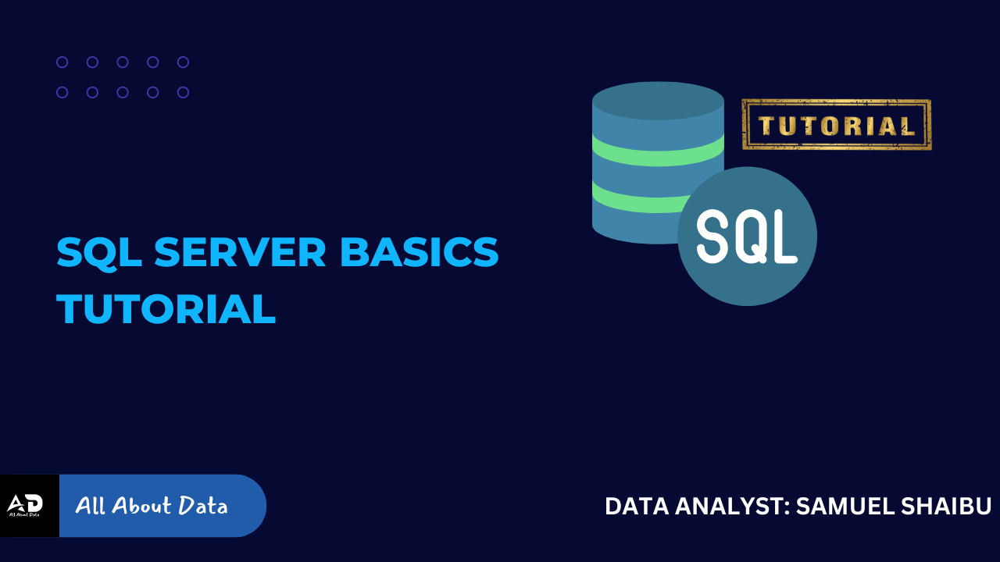

# SQL Tutorial



A hands-on companion to the *All About Data & More* SQL curriculum, from "what is a table?" to window functions, changing data, and turning business questions into metrics. Each notebook follows one newsletter lesson: it builds that lesson's small dataset so every result matches the article, works through the ideas with queries you run and change, shows the mistakes that return a wrong answer without an error, gives you exercises with worked solutions, and ends by running the same ideas on Microsoft's AdventureWorks database at real scale.

No prior experience is needed: [`01 - What Is a Database`](<01-what-is-a-database.ipynb>) starts from zero.

## Start here

Open [`00-course-overview.ipynb`](<00-course-overview.ipynb>) for the full guide. The short version:

- **Read on GitHub.** Every notebook is saved with its results, so you can read the whole course here without installing anything. GitHub can't run the cells, though, and changing a query to see what happens is where most of the learning is.
- **Run in Google Colab, with nothing to install.** Click the **Open in Colab** button at the top of any notebook and run the first cell. The AdventureWorks section of each notebook has a one-step setup cell that installs SQL Server inside your Colab session.
- **Run on your own computer.** Install Python 3.10 or later, then, in this folder:

  ```
  pip install -r requirements.txt
  jupyter lab
  ```

  The lessons need nothing else. For the AdventureWorks sections, you also need SQL Server with AdventureWorks restored; the Course Overview covers Windows, macOS, and Linux.

## The course

| # | Notebook | What it covers |
| --- | --- | --- |
| 01 | [What Is a Database](<01-what-is-a-database.ipynb>) | Tables, rows, columns, and why there is more than one table |
| 02 | [SQL Basics](<02-sql-basics.ipynb>) | `SELECT`, `WHERE`, `ORDER BY`, and where `NULL` hides |
| 03 | [Aggregation](<03-aggregation.ipynb>) | `GROUP BY`, `HAVING`, and how aggregates treat missing values |
| 04 | [JOINs](<04-joins.ipynb>) | `INNER` and `LEFT JOIN`, grain, and joins that corrupt a total |
| 05 | [Subqueries to CTEs](<05-subqueries-to-ctes.ipynb>) | Subqueries of every kind, and naming each step with `WITH` |
| 06 | [Window Functions, Part 1](<06-window-functions-part-1.ipynb>) | `OVER`, `PARTITION BY`, `ROW_NUMBER()`, and `LAG()` |
| 07 | [Window Functions, Part 2](<07-window-functions-part-2.ipynb>) | Frames, running totals, moving averages, and percentiles |
| 08a | [Changing Data, Part 1](<08a-changing-data-part-1.ipynb>) | `INSERT`, `UPDATE`, `DELETE`, and transactions |
| 08b | [Changing Data, Part 2](<08b-changing-data-part-2.ipynb>) | `CREATE TABLE`, constraints, foreign keys, and `ALTER TABLE` |
| 09 | [Thinking in Metrics](<09-thinking-in-metrics.ipynb>) | Turning a business question into a definition, then a query |
| A | [Appendix A - SQL Server Reference](<appendix-a-sql-server-reference.ipynb>) | Exploring a database, data types, and a T-SQL vs SQLite cheat sheet |

Worked answers to every exercise are in [`solutions/`](solutions/).

## Study guides and interview prep

[`study-guides/`](study-guides/) has a companion file for each notebook, with a concept recap, the roles and interview formats it shows up in, common mistakes, and interview questions with model answers. [`INTERVIEW_PREP.md`](INTERVIEW_PREP.md) ties them together track by track.

## Questions and corrections

Spotted an error, a broken link, or a result that doesn't match its lesson? Please [open an issue](https://github.com/samietex/SQL_Tutorial/issues). The reading version of this curriculum, and the roadmap it belongs to, is at [All About Data & More](https://aaboutdata.substack.com/p/start-here-from-beginner-to-job-ready).

## License

MIT, see [LICENSE](LICENSE). Written and maintained by Samuel Shaibu as part of *All About Data & More*.
